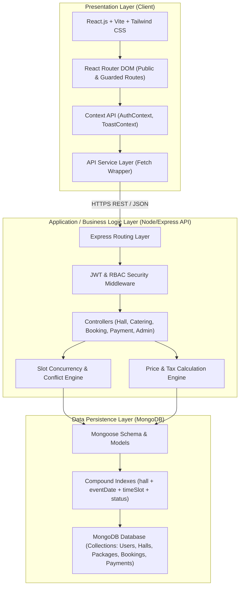
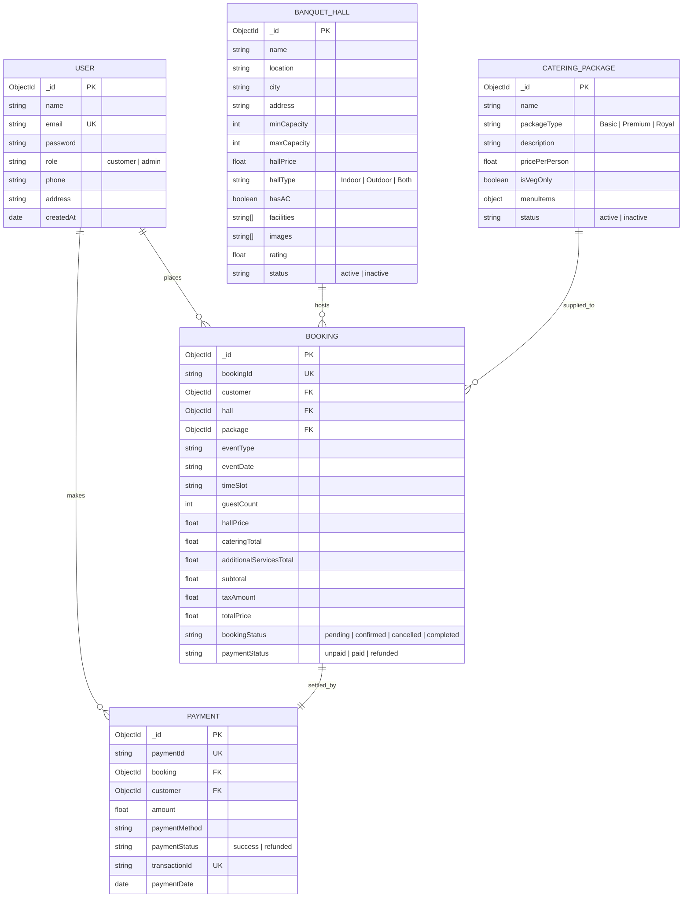
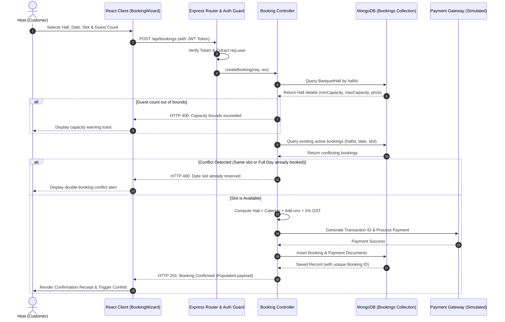
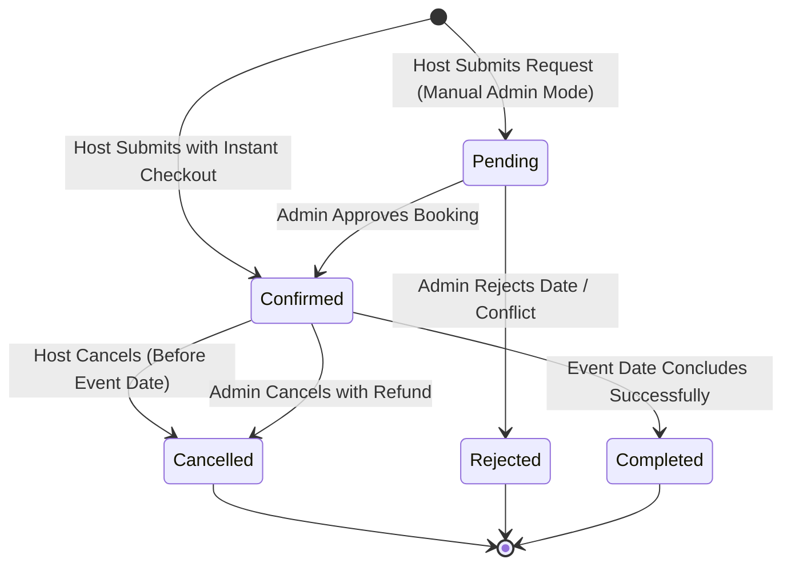

# BanquetFlow: System Design & Software Engineering (SESD) Report

**Project Title:** BanquetFlow – Banquet Hall Reservation, Catering Package & Management System  
**Academic Course:** Software Engineering and System Design (SESD)  
**Academic Year:** 2026  
**Technology Stack:** React.js, Vite, Tailwind CSS, Node.js, Express.js, MongoDB (Mongoose), JWT, bcrypt  

---

## 1. Problem Statement & Objectives

### 1.1 Problem Statement
The event venue booking and banquet management sector faces significant operational and customer experience challenges:
- **Scheduling Conflicts:** Manual reservation management leads to disastrous double bookings of popular slots.
- **Opaque Pricing Models:** Inflexible or hidden quotes for hall rentals and per-guest catering create friction and loss of trust.
- **Disjointed Catering Coordination:** Customizing dietary spreads and live food counters requires tedious back-and-forth communication.
- **Administrative Overhead:** Event organizers lack real-time visibility into revenue, customer history, and hall utilization metrics.

### 1.2 System Objectives
1. Provide customers with an intuitive, self-service platform to discover verified banquet halls and evaluate live date/time slot availability.
2. Deliver a configurable multi-course catering menu selection system with dynamic per-head budget calculators.
3. Guarantee zero overlapping reservations via automated database concurrency controls and compound indexing.
4. Provide venue administrators with complete inventory control, booking management, customer spend profiles, and analytical revenue reports.

---

## 2. Requirements Specification

### 2.1 Functional Requirements (FR)
- **FR1 (Authentication & Authorization):** The system must provide role-based authentication (Customer and Admin) using cryptographically signed JWTs and bcrypt salted hashes.
- **FR2 (Venue Discovery & Filtering):** The system must permit filtering banquet halls by location, budget range, guest capacity, climate control (AC/Non-AC), and indoor/outdoor environment.
- **FR3 (Dynamic Slot Availability):** The system must verify whether a chosen hall has open Morning, Evening, or Full Day slots for a targeted calendar date before accepting bookings.
- **FR4 (Capacity Bounds Enforcement):** The system must strictly validate that the user's guest count conforms to the venue's $minCapacity \le guestCount \le maxCapacity$.
- **FR5 (Configurable Catering Packages):** The system must offer tiered packages (Basic, Premium, Royal) with itemized course listings and customizable prices.
- **FR6 (Automated Itemized Cost Breakdown):** The system must compute costs using:
  $$\text{Total Price} = (\text{Hall Rental} + (\text{Guests} \times \text{Catering Price}) + \text{Add-ons}) \times 1.05 \text{ (5% GST)}$$
- **FR7 (Unique Reservation Tracking):** The system must issue a unique alphanumeric human-readable tracking identifier (e.g. `BF-2026-XXXXX`) upon confirmation.
- **FR8 (Customer Dashboard & Self-Service):** Customers must have access to their upcoming and completed events, printable invoice receipts, and self-service cancellation with simulated refunds.
- **FR9 (Administrative Inventory Control):** Admins must be empowered to create, update, deactivate, and remove banquet halls and catering packages.
- **FR10 (Analytics & Reporting):** Admins must receive aggregated monthly revenue cohorts, top-performing venues, package popularity distributions, and event category metrics.

### 2.2 Non-Functional Requirements (NFR)
- **NFR1 (Performance):** Search and filter responses must execute in $< 100\text{ ms}$ under normal database conditions.
- **NFR2 (Availability & Reliability):** Atomic reservation commits must prevent partial state records; payment simulation records must link directly to confirmed bookings.
- **NFR3 (Security):** Plaintext passwords and secrets must never be exposed over client bundles; routes must be guarded with JWT bearer verification.
- **NFR4 (Usability & Responsiveness):** The UI must render seamlessly across viewport breakpoints (360px mobile to 4K desktop) using luxury hospitality typography and styling.

---

## 3. Architectural Design

BanquetFlow follows a **3-Tier Layered Architecture** with strict separation of concerns:

---

## 4. Entity-Relationship (ER) Diagram

---

## 5. Sequence Diagram: Booking Creation & Conflict Check

---

## 6. State Machine: Reservation Lifecycle

---

## 7. Software Design Patterns Implemented

| Pattern | Location in Codebase | Purpose & Implementation |
|---|---|---|
| **MVC (Model-View-Controller)** | `server/models`, `client/src/pages`, `server/controllers` | Enforces modular separation of data schemas, client presentation, and business routing logic. |
| **Facade Pattern** | `client/src/services/api.js` | Abstracts the complexity of HTTP requests, authentication header injection, query string encoding, and error normalization. |
| **Strategy Pattern** | `server/controllers/bookingController.js` | Accommodates variable pricing algorithms (flat hall base rental vs per-head tiered catering vs optional add-on fees). |
| **Chain of Responsibility (Middleware Pipeline)** | `server/middleware/auth.js`, `server/middleware/errorHandler.js` | Sequentially processes authentication tokens, verifies administrator roles, and formats uncaught exceptions. |
| **Observer Pattern** | `client/src/context/ToastContext.jsx`, Custom Event `auth:expired` | Dispatches transient status notifications across detached UI components upon asynchronous event triggers. |

---

## 8. Academic Viva Voce (Oral Defense) Q&A Guide

#### Q1: How does BanquetFlow guarantee that two customers cannot book the same hall on the same day?
> **Answer:** Double booking prevention is enforced at both the schema layer and controller layer. At the database layer, a compound index on `{ hall: 1, eventDate: 1, timeSlot: 1, bookingStatus: 1 }` enables rapid lookups. When a booking request arrives, the controller checks whether any active (`confirmed` or `pending`) booking exists for that hall on that date with an overlapping slot (or a `Full Day` slot). If found, the transaction is rejected with an HTTP 400 error before any database insertion occurs.

#### Q2: How is security handled for sensitive operations like hall deletion and catering pricing updates?
> **Answer:** Security relies on dual-tier middleware (`protect` and `adminOnly`). The `protect` middleware decodes the JWT bearer token and attaches the authenticated user object to `req.user`. Next, the `adminOnly` middleware inspects `req.user.role`. If the role is not `'admin'`, it immediately halts execution with an HTTP 403 Forbidden status, ensuring customer tokens cannot invoke privileged management endpoints.

#### Q3: Why was MongoDB chosen over a relational SQL database for BanquetFlow?
> **Answer:** Banquet halls and catering menus have variable structures. For instance, catering packages contain dynamic menu courses (`welcomeDrinks`, `starters`, `mainCourse`, `desserts`, `liveCounters`), and halls contain arbitrary arrays of facilities, rules, and photo galleries. MongoDB's document model represents these nested subdocuments naturally without requiring multiple complex table joins, while still supporting relational references via Mongoose ObjectIds.

#### Q4: What happens if a customer attempts to book a hall for 1,500 guests when the hall capacity is only 800?
> **Answer:** Step 4 of the booking wizard validates guest count against both the lower bound (`minCapacity`) and upper bound (`maxCapacity`). Furthermore, the backend booking controller repeats this boundary validation on the payload. If `guestCount > hall.maxCapacity`, an error response is returned: `"Guest count (1500) exceeds maximum hall capacity (800)"`, preventing event overbooking.

#### Q5: How does the application handle currency and taxation?
> **Answer:** All monetary figures are stored and processed in Indian Rupees (₹). The price engine calculates the hall rental, calculates catering as $guestCount \times pricePerPerson$, aggregates any selected add-ons, applies a standard 5% GST itemization, and rounds the final sum. The frontend uses `Intl.NumberFormat('en-IN', { style: 'currency', currency: 'INR' })` to display consistent Indian currency notation.

---

*Report prepared for the Software Engineering & System Design Academic Demonstration.*

